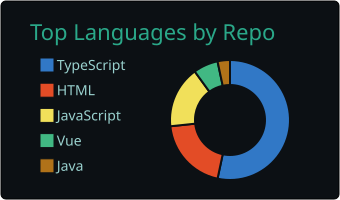
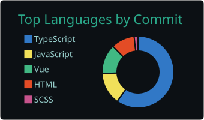

## Tsut-ps 👋

 

| | 🛠️ |
|---|---|
| かける / good | React (Next.js)　Vue.js (Nuxt)　TypeScript/JavaScript (Node.js) |
| ややかける / ok | CSS-Animation　Python　AWS　Cloudflare |
| がんばれば / fine | C++　Unity |

わたしが使うために作ったものがテキトーに置いてあります。ライセンスの許す限り、自由にお使いください。  
Things I made for my own use. Feel free to use them under their licenses.
